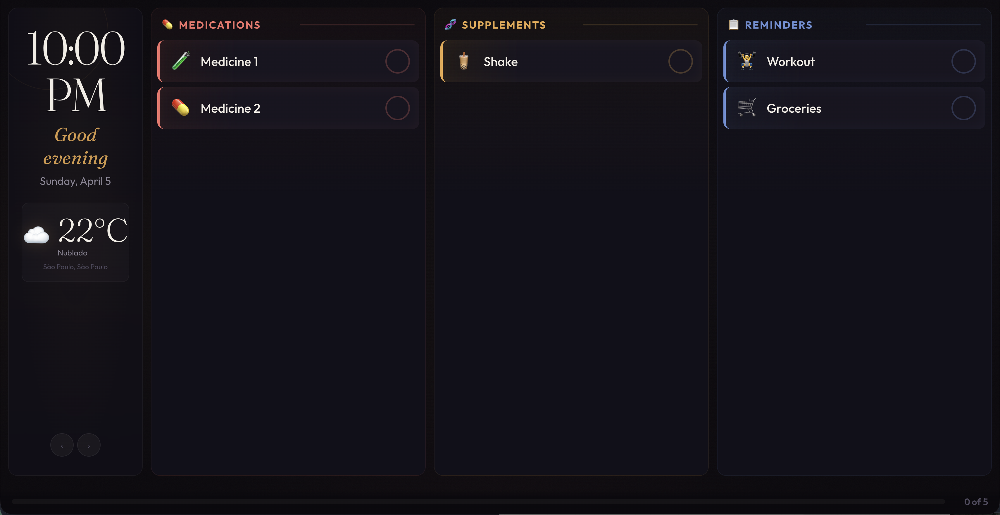
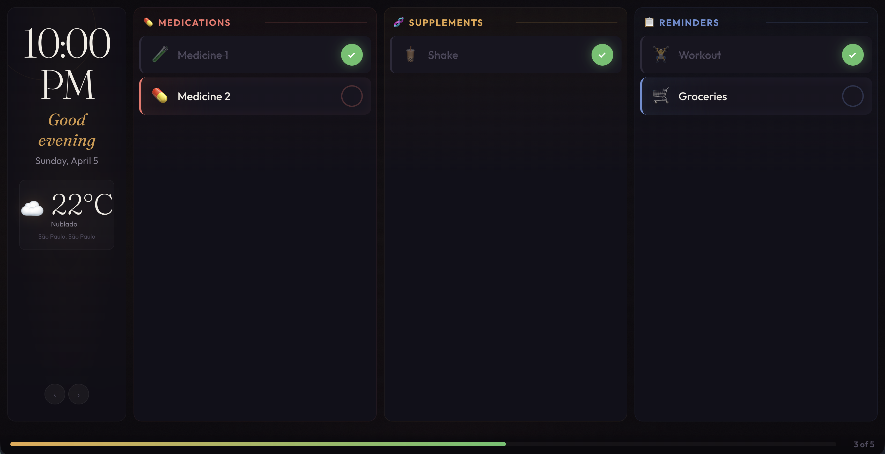
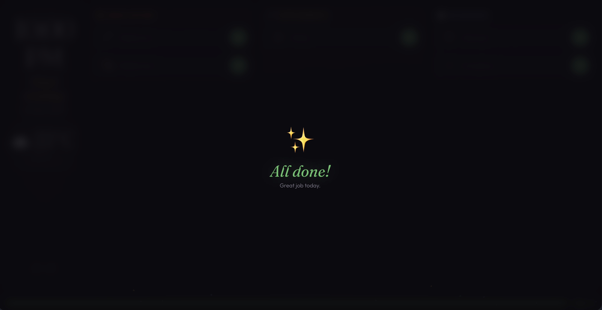
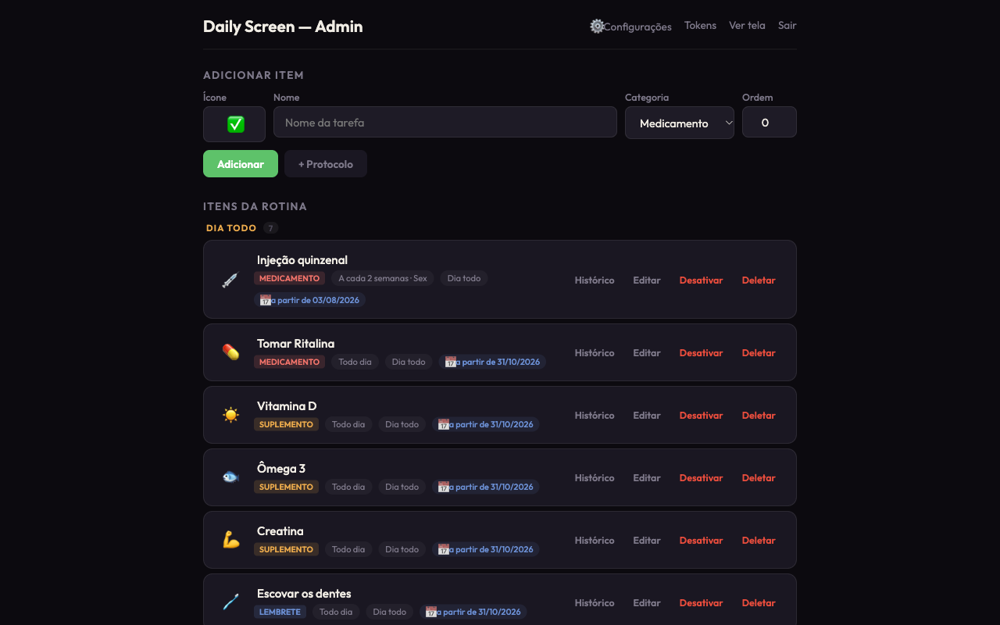
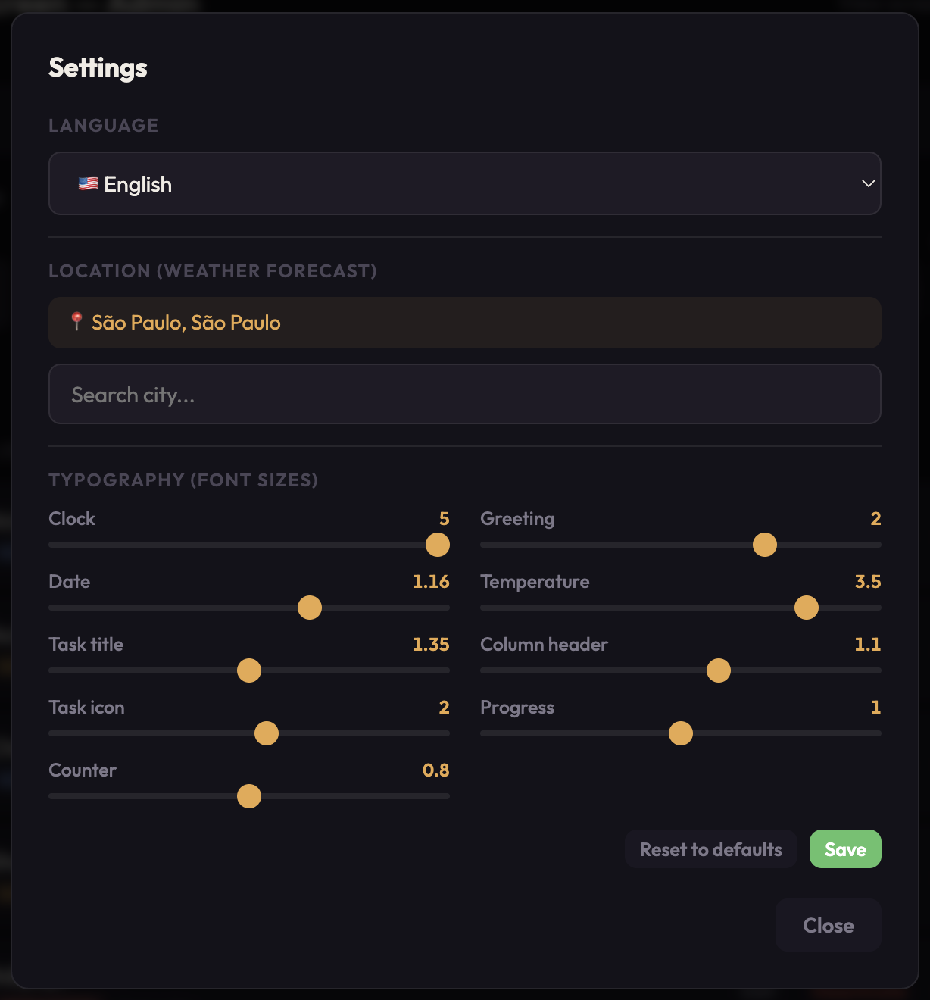
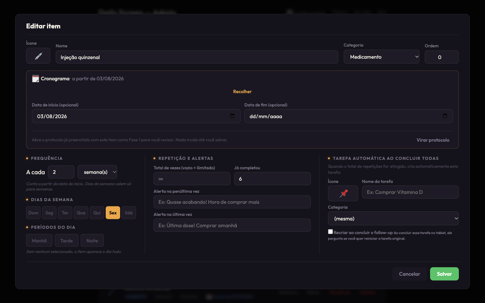
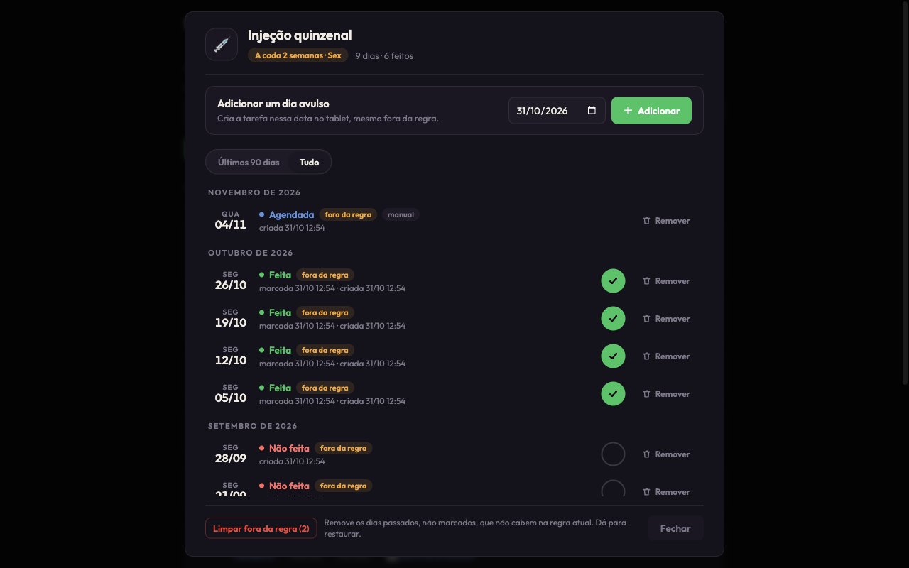
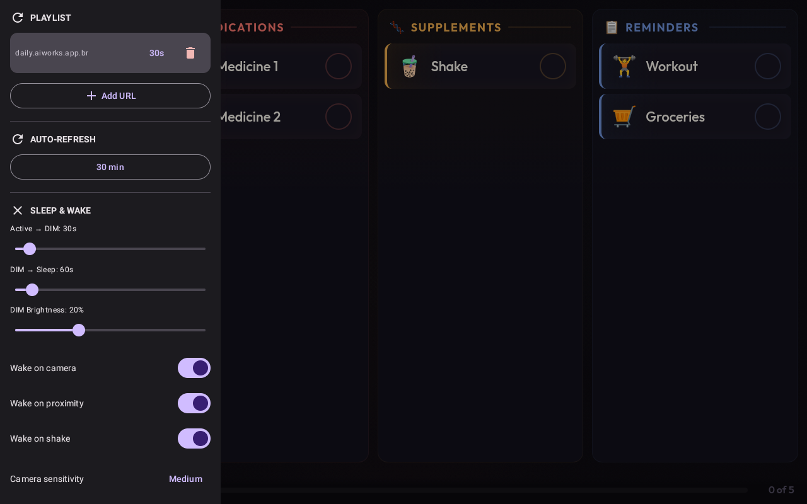
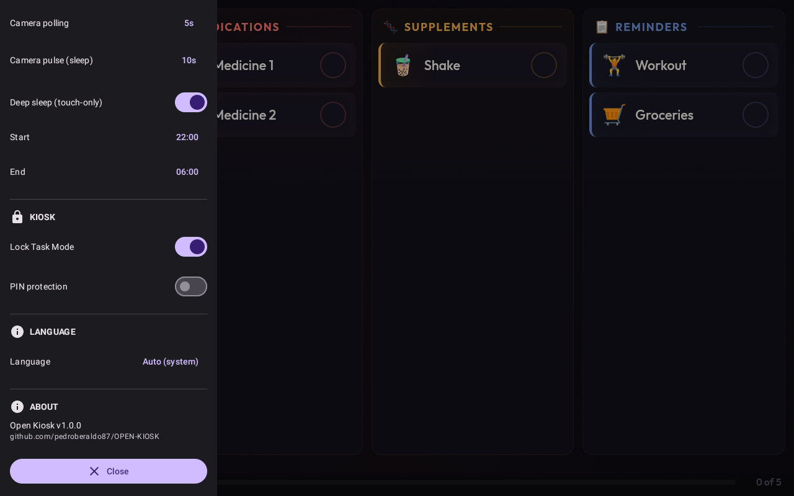

# Daily Screen

[](LICENSE)
[]()
[]()

## What is Daily Screen?

A wall-mounted daily assistant for tablets (Fire HD 8, 1280×800 landscape). Displays a daily checklist of medications, supplements, and reminders with progress tracking. Includes a web admin panel to manage items, real-time weather forecast, and intelligent date navigation with auto-reset on idle. Especially useful for people who tend to forget daily routines — like those with ADHD.

<table>
  <tr>
    <td align="center"><a href="docs/screenshots/display.png"></a><br><sub>Daily checklist</sub></td>
    <td align="center"><a href="docs/screenshots/display-progress.png"></a><br><sub>Progress tracking</sub></td>
    <td align="center"><a href="docs/screenshots/display-alldone.png"></a><br><sub>All done!</sub></td>
  </tr>
  <tr>
    <td align="center"><a href="docs/screenshots/admin.png"></a><br><sub>Admin panel</sub></td>
    <td align="center"><a href="docs/screenshots/settings.png"></a><br><sub>Settings</sub></td>
    <td align="center"><a href="docs/screenshots/edit-item.png"></a><br><sub>Edit item · repeat frequency</sub></td>
  </tr>
  <tr>
    <td align="center" colspan="3"><a href="docs/screenshots/history.png"></a><br><sub>History — see and fix every day of a repeated task</sub></td>
  </tr>
</table>

## Features

- **Daily checklist** — medications, supplements, reminders with emoji icons, split by period (morning/afternoon/night)
- **Repeat frequency** — every N days, weeks (on chosen weekdays) or months (day 31 falls on the last day of shorter months)
- **Boxes with a dose count** — e.g. a 30-pill box counts down as you mark doses; when it runs out a "Buy X" task appears, and "I bought it" starts a fresh box
- **Protocols** — dated phases in sequence (tapering, titration), each with its own schedule, plus end-of-protocol alerts
- **History & governance** — per item, see every day: when it was created, whether it was done, whether it still fits the rule; mark/unmark, remove/restore (always reversible), add a one-off day, or clean days that no longer fit the rule
- **Manual corrections** — fix the "already taken" count of a box by hand; changing the rule cleans pending days from today on
- **Non-destructive by default** — converting an item into a protocol only happens when you save; deleting from the tablet only archives
- **Progress tracking** — visual completion percentage; the screen follows midnight on its own
- **Weather forecast** — Open-Meteo integration (free, no API key)
- **Date navigation** — browse past/future days, auto-reset to today after 5 min idle
- **Admin panel** — password-protected item management and settings, in Portuguese, English or Spanish
- **Integration API** — token-authenticated REST surface so external agents can configure everything the panel can
- **No build step** — vanilla HTML/CSS/JS, runs directly in Node.js

## Quick Start

### Local Development

Requires Node.js 22.23.4+ and npm.

```bash
git clone https://github.com/pedroberaldo87/daily-screen.git
cd daily-screen

# Install dependencies
npm install

# Create .env from template
cp .env.example .env

# Edit .env with your values (at minimum, change ADMIN_PASSWORD)
nano .env

# Run development server
node --watch server.js
```

Open http://localhost:3000 in your browser. Admin panel at http://localhost:3000/admin (login with password from `.env`).

### Docker

Requires Docker and Docker Compose.

```bash
git clone https://github.com/pedroberaldo87/daily-screen.git
cd daily-screen

# Create shared Docker network (required for Caddy reverse proxy)
docker network create shared_web

# Create .env from template
cp docker/.env.example docker/.env

# Edit docker/.env with your values
nano docker/.env

# Start containers
docker compose up -d

# View logs
docker compose logs -f daily-screen-app
```

The app runs on port 3000 (internal). To expose via HTTPS, use Caddy or your preferred reverse proxy.

## Deploy to VPS

The project includes a parametrized deploy script that builds, uploads, and starts the app on a remote server.

```bash
DEPLOY_HOST=your-vps-ip DEPLOY_KEY=~/.ssh/your_key ./deploy.sh
```

**Environment variables:**
- **DEPLOY_HOST** (required) — VPS IP or hostname
- **DEPLOY_KEY** (required) — path to SSH private key
- **DEPLOY_USER** (optional, default: `root`)
- **DEPLOY_PATH** (optional, default: `/opt/daily-screen`)

The script:
1. Creates a local tarball (excludes `node_modules`, `.db`, `.git`, `.env`)
2. Uploads to `/tmp/daily-screen-deploy.tar.gz`
3. Prunes Docker to free space
4. Backs up production `.env`
5. Extracts tarball, restores `.env`
6. Builds and runs containers
7. Verifies container health
8. Cleans up temporary files

If `.env` doesn't exist on first deploy, create it manually on the VPS at the deploy path.

## Environment Variables

- **PORT** — Express server port (default: `3000`)
- **ADMIN_PASSWORD** — Password for admin panel login. Change this to a strong value in production.
- **SESSION_SECRET** — Secret key for session cookies. Use a random string.
- **DATABASE_PATH** — Path to SQLite database (default: `./daily-screen.db` for dev, `/data/daily-screen.db` for Docker)
- **WEATHER_LAT** — Default latitude for weather forecast (default: `-23.55`)
- **WEATHER_LON** — Default longitude for weather forecast (default: `-46.63`)
- **WEATHER_TZ** — Timezone for weather display (default: `America/Sao_Paulo`)

See **docker/.env.example** for production defaults.

## Architecture

Daily Screen follows a simple server-rendered architecture with no build step.

**Backend** — Express server handles:
- REST API for tasks, items, weather, settings
- Session-based admin authentication
- SQLite database with automatic migrations

**Frontend** — Vanilla HTML/CSS/JavaScript:
- **display.html** — tablet view (4-panel layout: clock, weather, checklist, progress)
- **admin.html** — admin panel (CRUD, settings, emoji picker)
- **sw.js** — service worker (currently inactive: its inline registration is blocked by the CSP, so the tablet picks up a new frontend on reload)

**Database** — SQLite with WAL mode (schema in **model.js**, upgraded in place on boot):
- `templates` — what you manage in the panel (item or protocol, follow-up settings, protocol alerts)
- `phases` — the schedule: weekdays, periods, repeat frequency, dose count, duration
- `series` — each concrete box / protocol phase, an immutable snapshot with its own counter and status
- `daily_tasks` — one row per series per day, lazy-generated, with creation time, origin (auto/manual) and reversible removal
- `settings`, `sessions`, `api_tokens`, `api_idempotency_keys`

### Directory Structure

```
daily-screen/
  server.js              # Express entry point
  model.js               # Data model: templates → phases → series → daily_tasks, box cycle, frequency
  db.js                  # Opens SQLite, runs the one-time migration, keeps the API names stable
  weather.js             # Open-Meteo fetch + 30min cache
  session-store.js       # Custom SQLite session store
  Dockerfile             # Multi-stage Node 22 Alpine
  deploy.sh              # VPS deploy script
  docker/
    docker-compose.yml   # Container orchestration
    .env.example         # Production env template
  routes/
    display.js           # GET / → tablet display
    admin.js             # POST /admin/login, GET /admin
    api.js               # REST API endpoints
    integration.js       # /integration/v1 (bearer token)
    occurrences.js       # History/governance routes, mounted on both APIs
  lib/
    validators.js        # Request validation and normalization
  middleware/
    auth.js              # Session authentication
    token-auth.js        # Bearer tokens for the Integration API
  test/                  # node --test suites (in-memory SQLite)
  public/
    style.css            # Design system (Ember Night palette)
    display.js           # Tablet display logic (clock, weather, tasks, date nav)
    admin.js             # Admin panel logic (CRUD, settings)
    icon-picker.js       # Emoji picker with PT-BR search
    utils.js             # Shared utilities (escapeHtml)
    sw.js                # Service worker (offline + cache strategies)
    manifest.json        # PWA manifest
  views/
    display.html         # Tablet UI
    admin.html           # Admin panel UI
    login.html           # Login page
```

### Key Patterns

**Lazy task generation** — daily_tasks are created on-demand when you call `GET /api/tasks?date=YYYY-MM-DD`: one per active series whose rule (weekdays + frequency, inside its date window) falls on that date. Removing a day in History leaves a tombstone, so it is not regenerated.

**CSS custom properties** — Font sizes are stored in the database and applied as CSS variables. Admin can adjust `--fs-clock`, `--fs-greeting`, etc. in real-time.

**Emoji icons** — Tasks use Unicode emoji stored as text in SQLite. The emoji picker provides searchable selection with Portuguese-Brazilian keywords.

**Service worker** — **public/sw.js** implements cache-first for the shell and network-first for the API, but it never registers today (the inline registration script is blocked by the Content-Security-Policy). After a frontend deploy, reload the tablet once.

## API Endpoints

All endpoints are prefixed with `/api`.

**Public (no auth required):**
- `GET /api/tasks?date=YYYY-MM-DD` — Get tasks for date (lazy-generates if needed)
- `POST /api/tasks/:id/toggle` — Mark/unmark task as complete
- `DELETE /api/tasks/:id` — From the tablet: archives the item behind the task (reversible in the panel)
- `GET /api/items` — List all routine items
- `GET /api/weather` — Weather forecast (cached 30 min)
- `GET /api/geocoding?q=cidade` — Search cities (Open-Meteo)
- `GET /api/settings` — Get all settings

**Auth required (admin session):**
- `POST /api/items` — Create routine item
- `PUT /api/items/:id` — Update routine item
- `DELETE /api/items/:id` — Soft delete (deactivate)
- `DELETE /api/items/:id/permanent` — Hard delete
- `POST /api/items/:id/convert-to-protocol` — Turn an item into a protocol (send the full protocol form to convert in one step, keeping the box history)
- `GET/POST/PUT/DELETE /api/protocols[/:id]` — Protocols (`?include_inactive=1` lists archived ones)
- `GET /api/items/:id/occurrences` — Every day of an item (History)
- `POST /api/items/:id/occurrences` — Add a one-off day · `POST /api/items/:id/occurrences/prune` — clean off-rule days (`dry_run` to preview)
- `PUT /api/occurrences/:id` (`completed` / `removed`) · `DELETE /api/occurrences/:id` — mark, unmark, remove, restore
- `PUT /api/settings` — Update settings (key-value pairs)

### Integration API (token-authenticated)

For external agents (scripts, cron jobs, other LLM-driven tools), there's a parallel token-authenticated surface at `/integration/v1/*` with full CRUD coverage of items, protocols, tasks, settings, the day-by-day History of each item (`/integration/v1/items/:id/occurrences`), and adherence/history analytics. Tokens are managed in the admin panel under **Tokens** (top nav). A valid token currently has full access to the whole integration surface (no per-token scopes yet).

See [`docs/2026-04-20-integration-api.md`](docs/2026-04-20-integration-api.md) for the complete guide — includes data models, endpoint reference with curl + Node.js examples, gotchas, and a ready-to-copy skill template for Claude Code.

```bash
curl -H "Authorization: Bearer dsk_live_..." \
  https://daily.aiworks.app.br/integration/v1/health
```

## Running on a Tablet

For the best experience on an Android tablet (e.g., Fire HD 8), use [Open Kiosk](https://github.com/pedroberaldo87/open-kiosk) — a lightweight kiosk browser that locks the tablet to a single URL in fullscreen mode. Just point it to your Daily Screen instance and mount the tablet on the wall.

<table>
  <tr>
    <td align="center"><a href="docs/screenshots/open-kiosk-playlist.png"></a><br><sub>Playlist & Sleep settings</sub></td>
    <td align="center"><a href="docs/screenshots/open-kiosk.png"></a><br><sub>Kiosk & Language settings</sub></td>
  </tr>
</table>

## Contributing

Found a bug? Have a feature idea? Contributions are welcome.

1. Fork the repo
2. Create a feature branch (`git checkout -b feature/my-feature`)
3. Make your changes
4. Test locally
5. Commit and push
6. Open a pull request

Please follow the existing code style (CommonJS imports, no TypeScript, vanilla JS). For major changes, open an issue first to discuss.

See [CONTRIBUTING.md](CONTRIBUTING.md) for guidelines.

## License

This project is licensed under the [GNU General Public License v3.0](LICENSE). See LICENSE file for details.

---

**Built for daily routines you can't afford to forget. Works offline. No tracking. Open source.**
