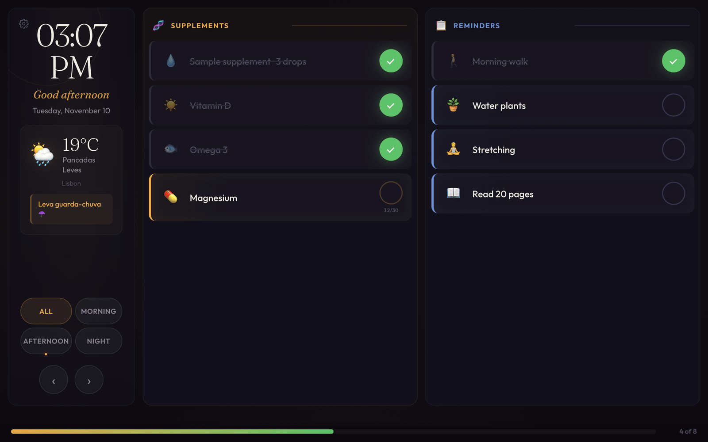
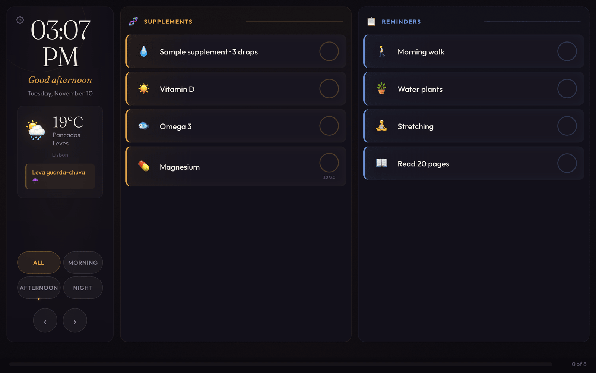
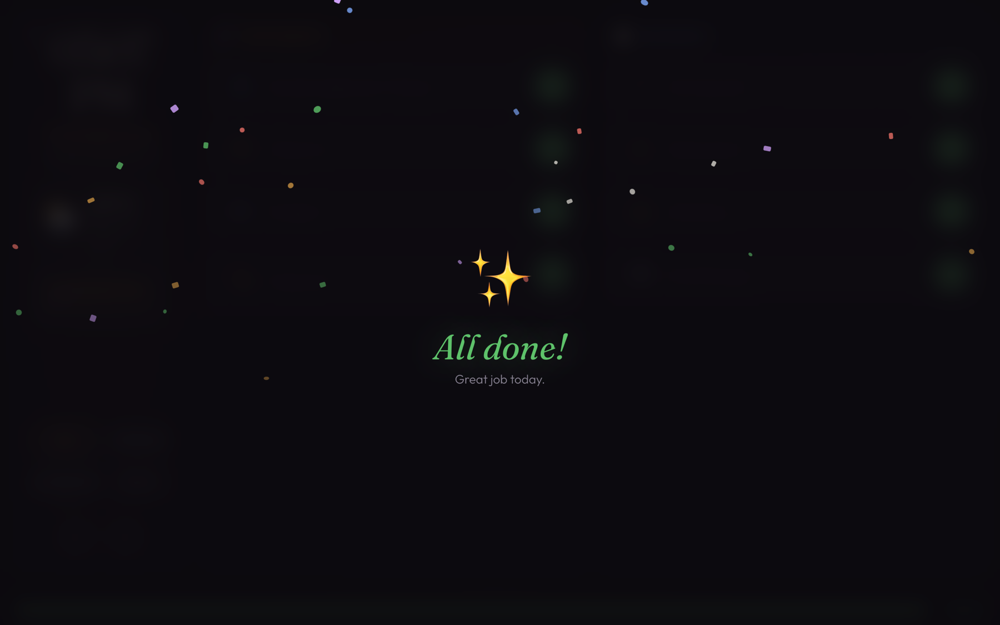
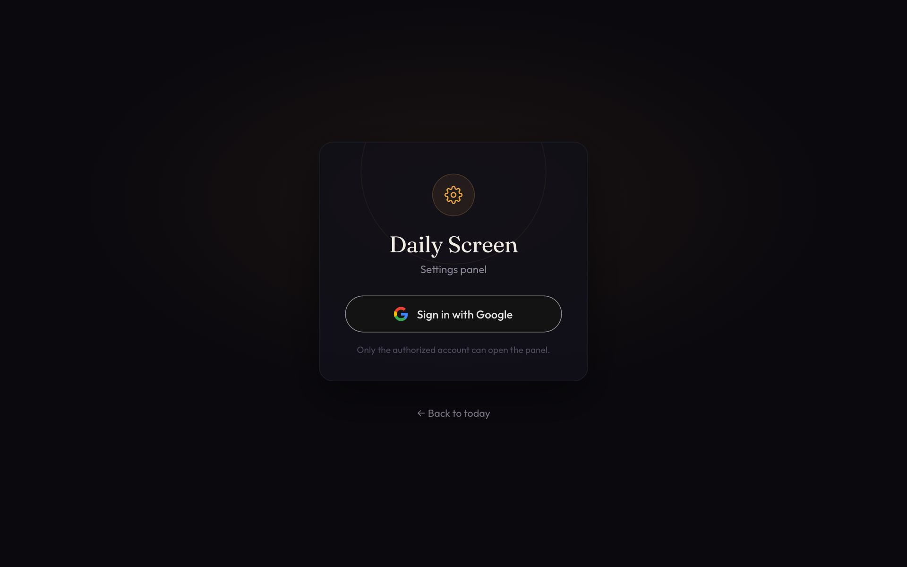
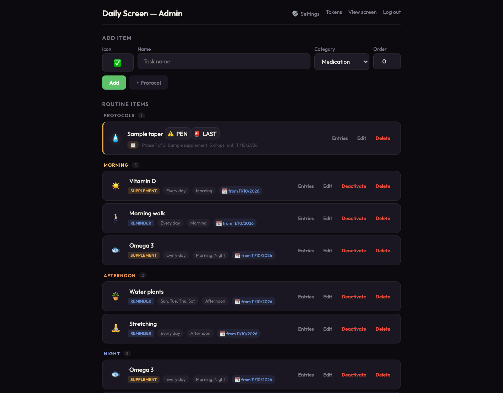
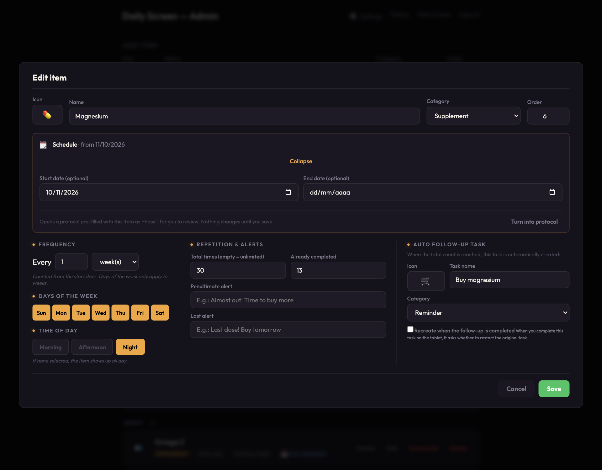
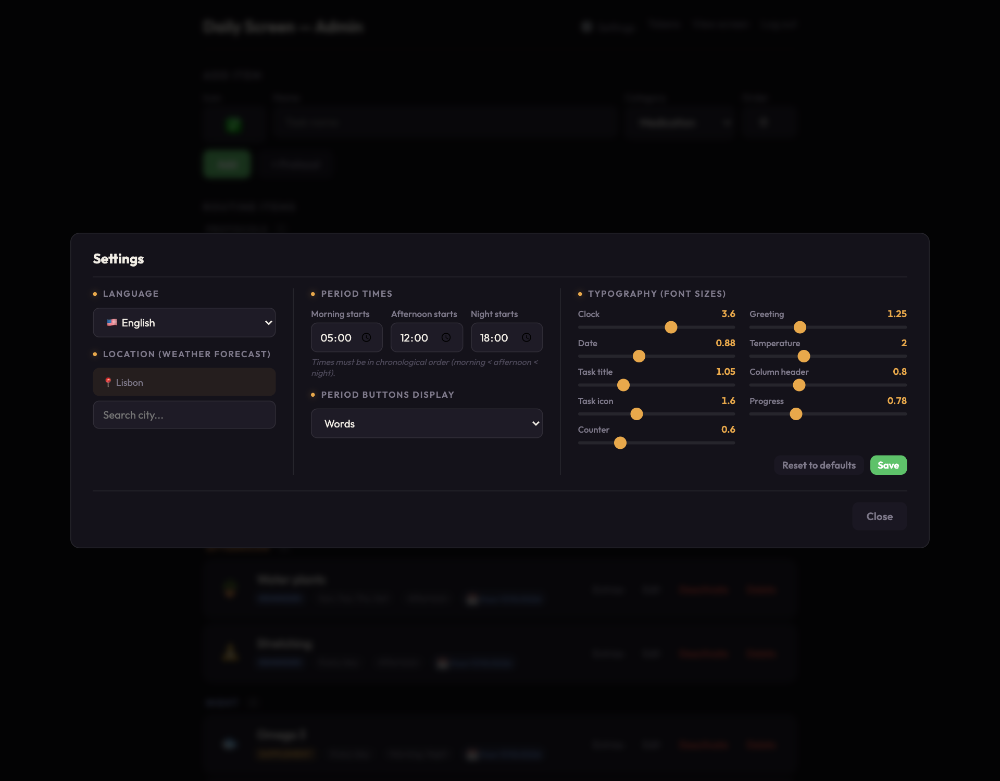
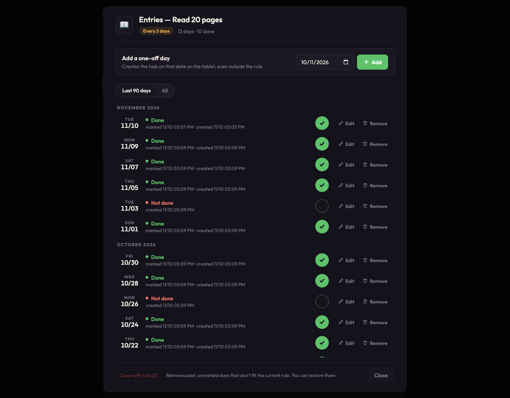
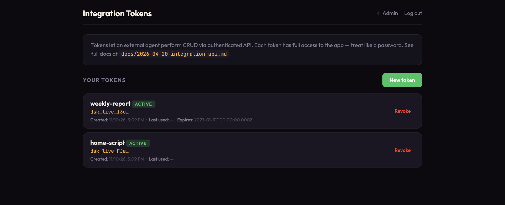
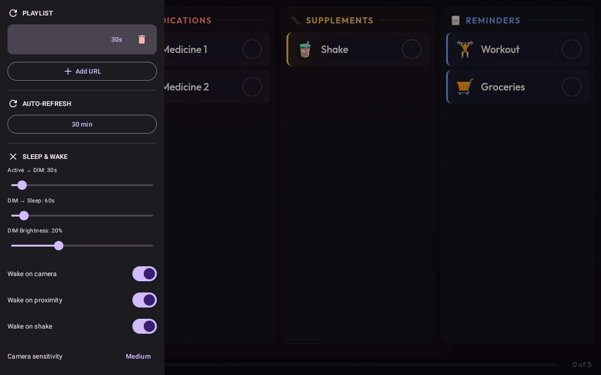

# Daily Screen

A self-hosted daily checklist for a wall-mounted tablet (built for a 1280×800 landscape screen). It shows medications, supplements and reminders for the day, tracks progress, and comes with a web admin panel. It is meant for people who forget daily routines, for example with ADHD.

**English** · [Português](README.pt-BR.md)

[](LICENSE)
[](package.json)
[](Dockerfile)

<p align="center">
  
</p>

*All screenshots in this repository use made-up demo data.*

## Features

- **Daily checklist** of medications, supplements and reminders with emoji icons, filtered by period (morning, afternoon, night).
- **Repeat rules**: every N days, weeks (on chosen weekdays) or months (day 31 falls on the last day of shorter months).
- **Boxes with a dose count**: a 30-pill box counts down as you mark doses. When it runs out, a "Buy X" task appears, and "I bought it" starts a fresh box.
- **Protocols**: dated phases in sequence (tapering, titration), each with its own schedule, plus alerts near the end.
- **Entries**: for each item, see every day, whether it was done and whether it still fits the rule. Mark or unmark, change the date, remove or restore, add a one-off day, or clean days that no longer fit.
- **Manual corrections** of a box's "already taken" count.
- **Non-destructive by default**: deleting from the tablet only archives the item.
- **Progress bar** that follows midnight on its own.
- **Weather** from Open-Meteo (free, no API key).
- **Date navigation** with automatic return to today after 5 minutes idle.
- **Admin panel** with Google sign-in, in Portuguese, English or Spanish.
- **Integration API**: bearer-token REST API so scripts and agents can do what the panel does.
- **No build step**: Node.js + Express + SQLite, plain HTML/CSS/JS on the front end.

## Quick start

You need Node.js 22.23.4 or newer, or Docker.

The server refuses to start without the Google OAuth settings and `SESSION_SECRET`. The tablet display at `/` works with placeholder Google values. To sign in to the admin panel you need a real Google OAuth client, see [Configuration](#configuration).

### Local

```bash
git clone https://github.com/pedroberaldo87/daily-screen.git
cd daily-screen
npm install
cp .env.example .env
# edit .env: GOOGLE_CLIENT_ID, GOOGLE_CLIENT_SECRET, ADMIN_EMAILS, SESSION_SECRET
npm start          # or: npm run dev (restarts on file changes)
```

Open http://localhost:3000 for the display and http://localhost:3000/admin for the panel. A new database starts with six sample items (with Portuguese titles); delete them in the panel.

### Docker

```bash
docker build -t daily-screen .
docker run -d --name daily-screen -p 3000:3000 \
  -e GOOGLE_CLIENT_ID=... -e GOOGLE_CLIENT_SECRET=... \
  -e ADMIN_EMAILS=you@example.com -e SESSION_SECRET=$(openssl rand -hex 32) \
  -v daily-screen-data:/data \
  daily-screen
```

The image sets `NODE_ENV=production`, so the session cookie is `Secure`: put the container behind an HTTPS reverse proxy (admin sign-in will not work over plain HTTP outside `localhost`). The database lives in the `/data` volume.

### Docker Compose and VPS

`docker/docker-compose.yml` is what the author runs behind a Caddy reverse proxy. It joins an external Docker network called `shared_web` and does not publish any port.

```bash
docker network create shared_web
cp docker/.env.example docker/.env     # then edit it
cd docker && docker compose up -d
```

`deploy.sh` packs the project, uploads it over SSH, rebuilds the containers on a server and checks that the container is running. It keeps the server's `docker/.env` between deploys.

```bash
DEPLOY_HOST=your-server DEPLOY_KEY=~/.ssh/your_key ./deploy.sh
```

| Variable | Required | Default |
|---|---|---|
| `DEPLOY_HOST` | yes | none |
| `DEPLOY_KEY` | yes | none |
| `DEPLOY_USER` | no | `root` |
| `DEPLOY_PATH` | no | `/opt/daily-screen` |

On the first deploy, create `$DEPLOY_PATH/docker/.env` on the server by hand.

## Configuration

Environment variables (read from the process or from a `.env` file):

| Variable | Required | Default | Notes |
|---|---|---|---|
| `GOOGLE_CLIENT_ID` | yes | none | OAuth client of type "Web application". |
| `GOOGLE_CLIENT_SECRET` | yes | none | |
| `ADMIN_EMAILS` | yes | none | Comma-separated Google accounts allowed into the panel. |
| `SESSION_SECRET` | yes | none | Long random string that signs the session cookie. |
| `PORT` | no | `3000` | |
| `DATABASE_PATH` | no | `./daily-screen.db` | The Docker image uses `/data/daily-screen.db`. |
| `WEATHER_LAT`, `WEATHER_LON` | no | `-23.55`, `-46.63` | Fallback location. The city picked in the panel overrides them. |
| `WEATHER_TZ` | no | `America/Sao_Paulo` | IANA time zone for the weather request. |
| `DISPLAY_KEY` | for the tablet | none | Pairing key for the wall display, at least 32 random characters (`openssl rand -hex 32`). Without it no display can be paired. See [Pairing the tablet](#pairing-the-tablet). |
| `NODE_ENV` | no | unset | `production` turns on `Secure` cookies and trusts one proxy hop. |

In the Google Cloud Console, add this authorized redirect URI: `https://<your-domain>/admin/auth/google/callback` (and `http://localhost:3000/admin/auth/google/callback` for local use).

Language, weather city, period start times, period button style and font sizes are not environment variables. They are saved in the database from the panel's **Settings**.

## Usage

**Tablet.** Pair it once (below), then open the root URL. Tap a circle to mark a task, use the period buttons to filter, and the arrows to look at other days. For a kiosk setup on Android, [Open Kiosk](https://github.com/pedroberaldo87/open-kiosk) locks the tablet to one URL.

**Admin panel.** Go to `/admin` and sign in with Google. From there you add and edit items and protocols, open **Entries** for any item, create API tokens under **Tokens**, and change **Settings**.

<table>
  <tr>
    <td align="center"><a href="docs/screenshots/display.png"></a><br><sub>Daily checklist</sub></td>
    <td align="center"><a href="docs/screenshots/display-alldone.png"></a><br><sub>All done</sub></td>
    <td align="center"><a href="docs/screenshots/login.png"></a><br><sub>Admin sign-in</sub></td>
  </tr>
  <tr>
    <td align="center"><a href="docs/screenshots/admin.png"></a><br><sub>Admin panel</sub></td>
    <td align="center"><a href="docs/screenshots/edit-item.png"></a><br><sub>Edit item</sub></td>
    <td align="center"><a href="docs/screenshots/settings.png"></a><br><sub>Settings</sub></td>
  </tr>
  <tr>
    <td align="center"><a href="docs/screenshots/history.png"></a><br><sub>Entries</sub></td>
    <td align="center"><a href="docs/screenshots/tokens.png"></a><br><sub>Integration tokens</sub></td>
    <td align="center"><a href="docs/screenshots/open-kiosk-playlist.png"></a><br><sub>Open Kiosk (the URL is hidden)</sub></td>
  </tr>
</table>

### Integration API

Scripts and agents can use a token-authenticated API under `/integration/v1/*`. It covers items, protocols, tasks, settings, the day-by-day entries of each item, history and adherence summaries. Create a token in the panel under **Tokens**; the value is shown once. Tokens start with `dsk_live_`, only a SHA-256 hash is stored, and each token has full access to the integration API (there are no scopes yet). The limit is 120 requests per minute per token.

```bash
export DS_TOKEN=dsk_live_...
curl -H "Authorization: Bearer $DS_TOKEN" https://your-domain.example/integration/v1/health
```

The full guide, with data models, every endpoint and examples, is in [docs/2026-04-20-integration-api.md](docs/2026-04-20-integration-api.md).

### Pairing the tablet

The display page shows "This display is not paired" until the device is paired once:

1. Set `DISPLAY_KEY` in the server's `.env` and restart.
2. On the tablet, open `https://<your-domain>/?key=<DISPLAY_KEY>` once. The server sets a long-lived `HttpOnly`, `SameSite=Strict` cookie and redirects to the clean URL.

To unpair every display, change or remove `DISPLAY_KEY`. The key travels in the URL once, so treat it as a password and rotate it if it leaks.

### Routes used by the app itself

All under `/api`. Every route needs an admin session, an integration token (`Authorization: Bearer ...`) or a paired display; without one it returns `401`.

| Who can call | Routes |
|---|---|
| Admin, token or paired display | `GET /tasks?date=YYYY-MM-DD`, `POST /tasks/:id/toggle`, `POST /tasks/:id/recreate`, `GET /completed`, `GET /weather`, `GET /settings` (latitude/longitude only for the admin session) |
| Admin or token only (a paired display gets `403`) | `DELETE /tasks/:id` (archives), `GET /items`, `POST/PUT/DELETE /items[/:id]`, `DELETE /items/:id/permanent`, `POST /items/:id/convert-to-protocol`, `GET/POST/PUT/DELETE /protocols[/:id]`, `PUT /settings`, `GET /items/:id/occurrences`, `POST /items/:id/occurrences[/prune]`, `PUT/DELETE /occurrences/:id`, `GET /geocoding?q=...` |

Token management is under `/admin/api/tokens` and needs an admin session.

## How it works

Server-rendered pages and a small JSON API, with no build step.

- **Backend**: Express 5, `express-session` with a SQLite session store, Helmet for security headers, `express-rate-limit`.
- **Frontend**: `views/*.html` plus vanilla JS in `public/`. The three languages are in `public/lang/`.
- **Data**: SQLite (`better-sqlite3`, WAL mode). The schema lives in `model.js` and is upgraded in place at startup.
  - `templates`: what you manage in the panel (an item or a protocol)
  - `phases`: the schedule (weekdays, periods, repeat rule, dose count, duration)
  - `series`: each concrete box or protocol phase, with its own counter and status
  - `daily_tasks`: one row per series per day, created on demand
  - `settings`, `sessions`, `api_tokens`, `api_idempotency_keys`
- **Tasks are created lazily.** The first `GET /api/tasks?date=...` for a day creates that day's rows from the active series. Removing a day in Entries leaves a marker, so it is not created again.
- **Sign-in** is Google OpenID Connect (authorization code flow). Only the emails in `ADMIN_EMAILS` get a session.
- **Weather** comes from Open-Meteo and is cached for 30 minutes.

```
server.js            Express entry point
model.js             data model: templates, phases, series, daily_tasks
db.js                opens SQLite and exposes the helpers the routes use
weather.js           Open-Meteo client with a 30-minute cache
session-store.js     SQLite session store
routes/              display, admin (login), admin-tokens, api, integration, occurrences
middleware/          session check and bearer-token check
lib/                 request validation, Google OAuth
public/              CSS, display and admin scripts, emoji picker, i18n, service worker
views/               display, admin, tokens and login pages
test/                node:test suites (in-memory SQLite)
docker/              Compose file and env template
```

Known limitations:

- The weather description and the umbrella/coat hint are written in Portuguese by the server, whatever language is selected.
- `public/sw.js` (a service worker) is in the repo but never runs: the page registers it from an inline script, which the Content-Security-Policy blocks. The tablet picks up new front-end code when you reload it.

## Development

```bash
npm install
npm test        # runs the node:test suites in test/ (needs Node.js 22+)
npm run dev     # server with file watching
```

There is no linter or formatter configured. The code is CommonJS with 2-space indentation.

## Security

See [SECURITY.md](SECURITY.md) for how to report a vulnerability. If you expose an instance on the internet, serve it over HTTPS and keep `SESSION_SECRET`, the Google client secret and your API tokens private.

## Contributing

Issues and pull requests are welcome. See [CONTRIBUTING.md](CONTRIBUTING.md) and the [Code of Conduct](CODE_OF_CONDUCT.md).

## License

[GNU General Public License v3.0](LICENSE).
