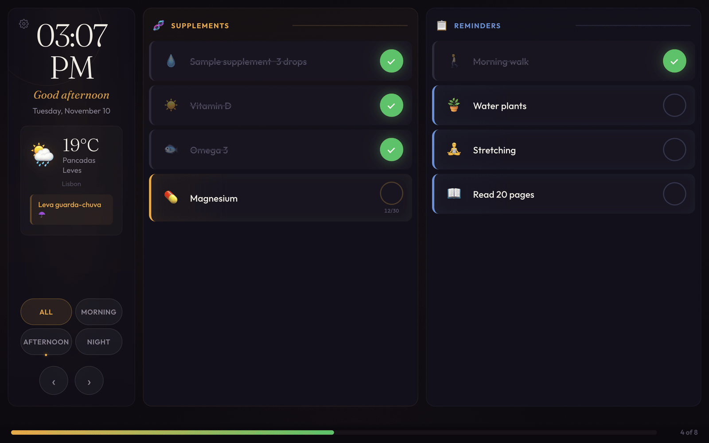
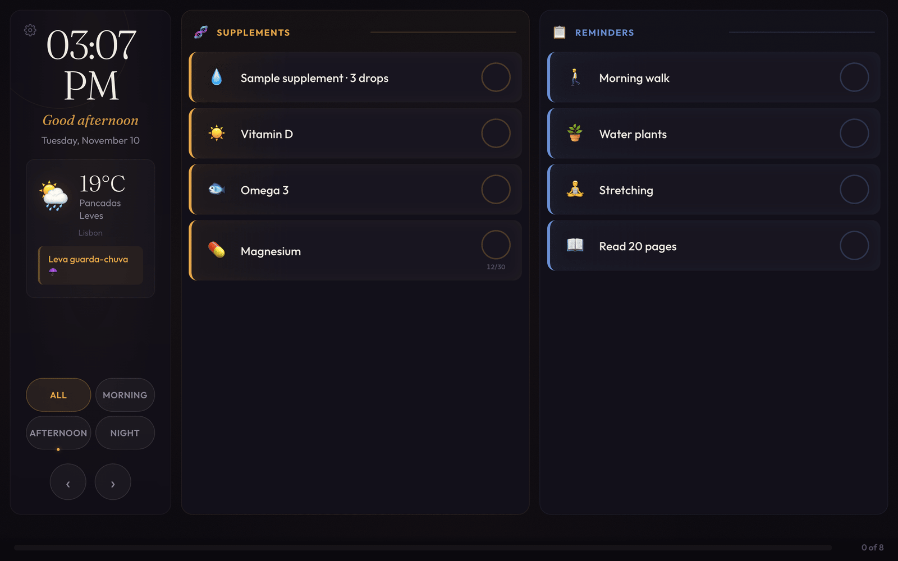
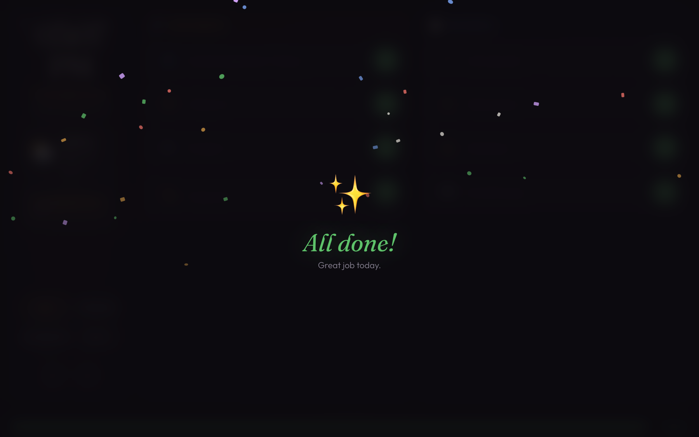
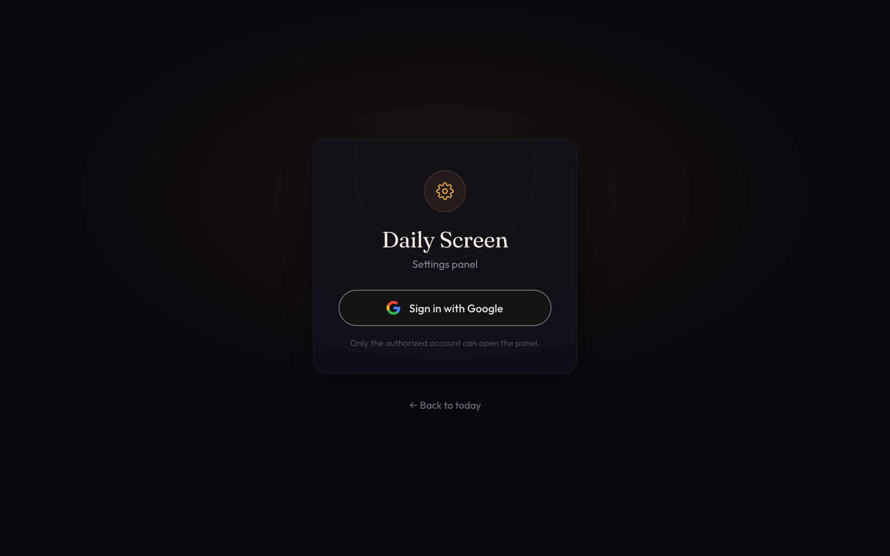
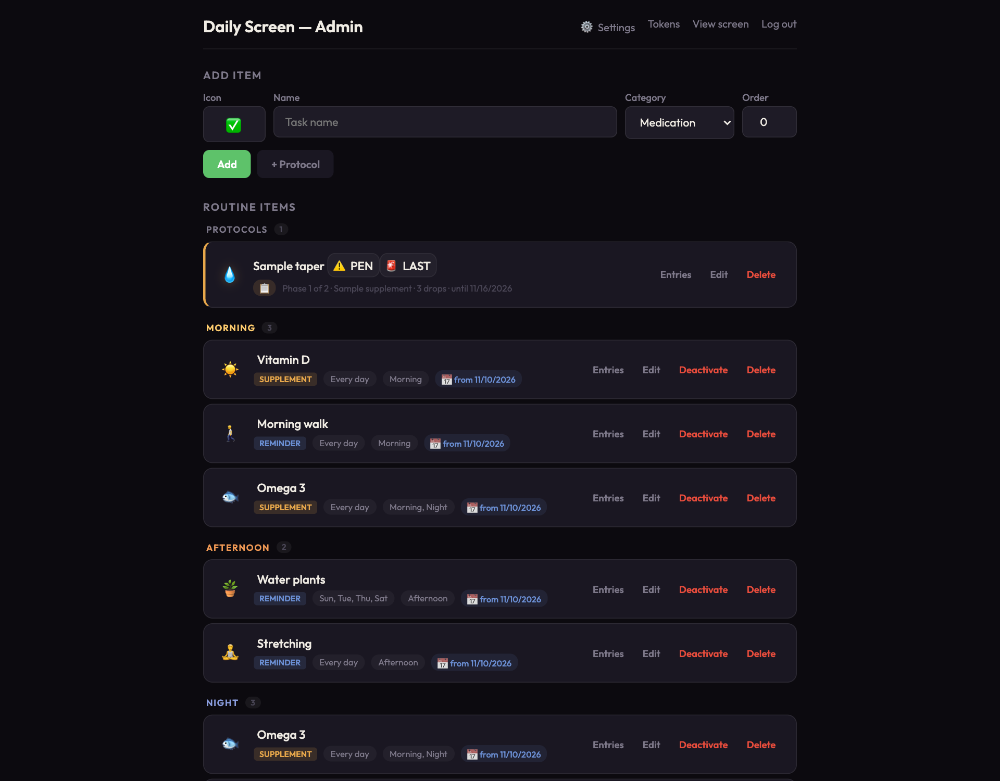
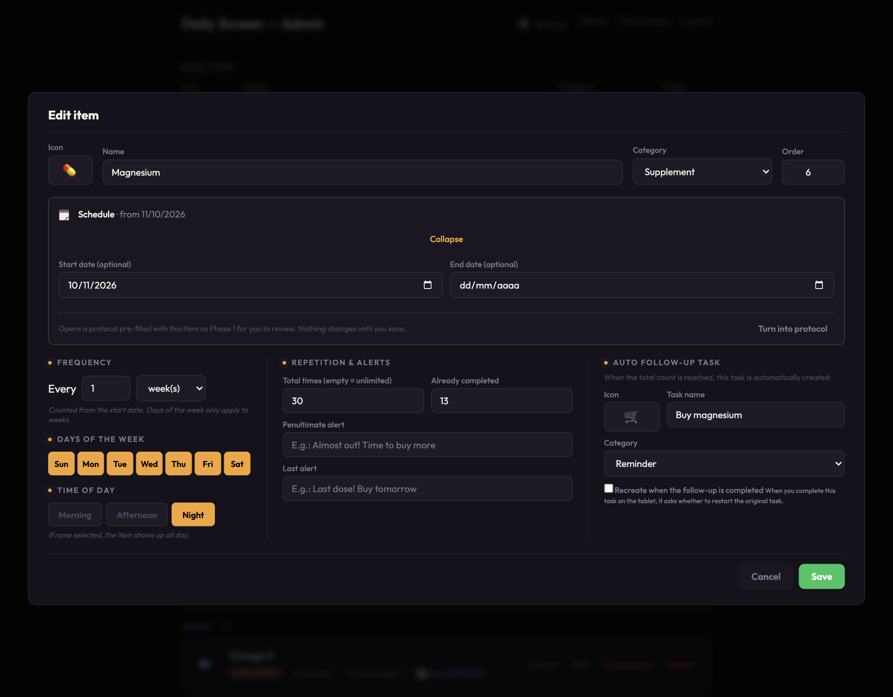
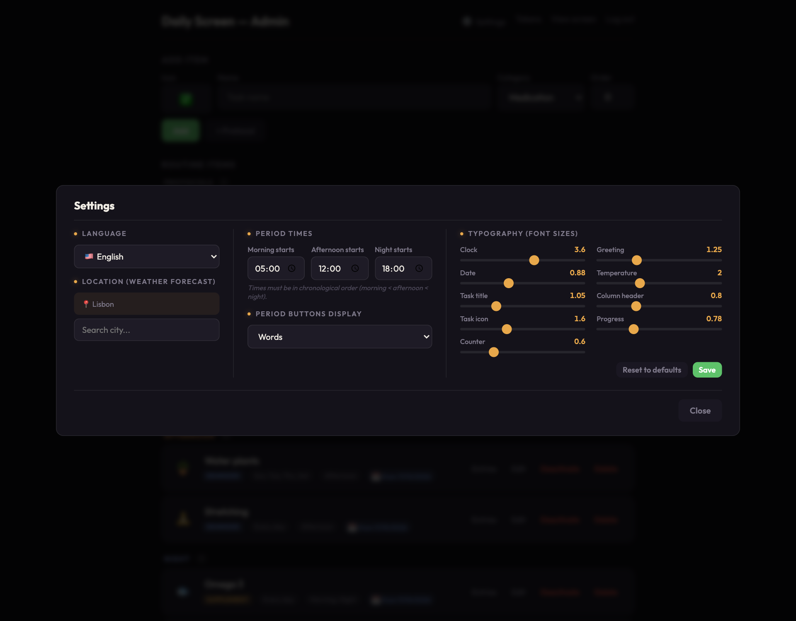
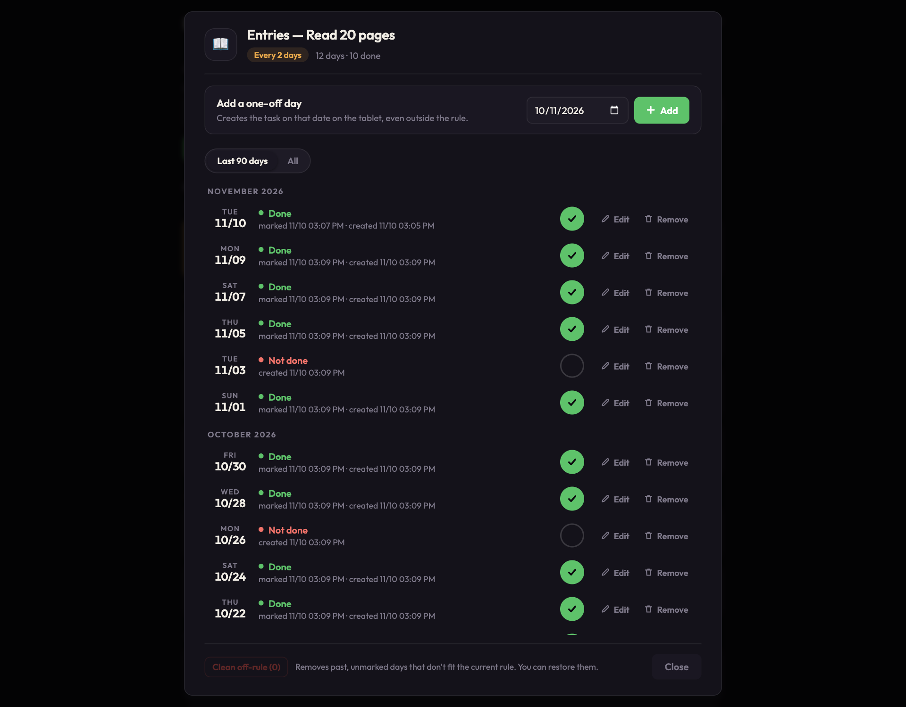
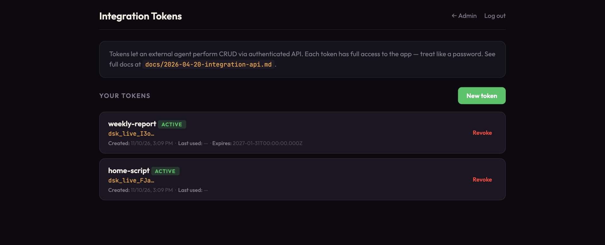
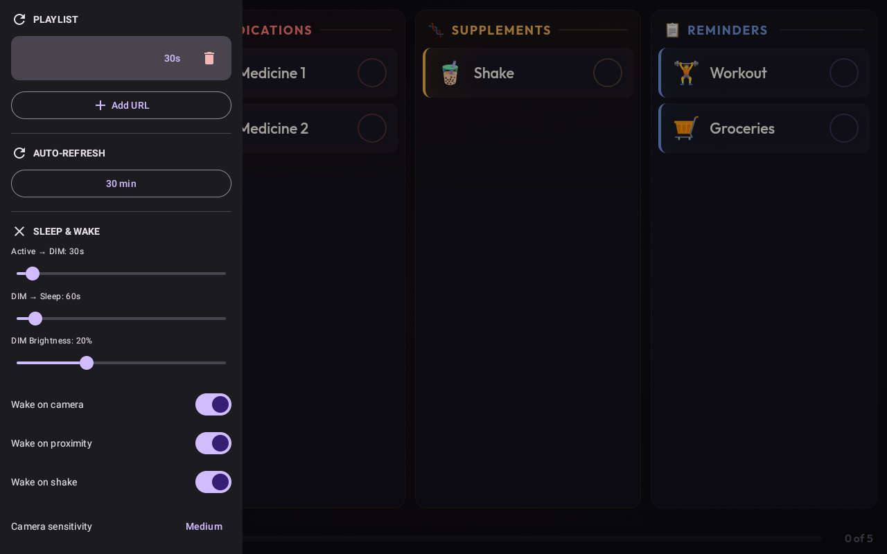

# Daily Screen

Uma lista diária self-hosted para um tablet fixado na parede (feita para tela de 1280×800 na horizontal). Mostra os remédios, suplementos e lembretes do dia, acompanha o progresso e vem com um painel web de administração. Serve para quem esquece a rotina do dia a dia, por exemplo pessoas com TDAH.

[English](README.md) · **Português**

[](LICENSE)
[](package.json)
[](Dockerfile)

<p align="center">
  
</p>

*Todas as capturas de tela deste repositório usam dados de demonstração inventados. A interface está em inglês nas imagens; ela também funciona em português e espanhol.*

## Funcionalidades

- **Lista diária** de remédios, suplementos e lembretes, com ícones de emoji, filtrada por período (manhã, tarde, noite).
- **Regras de repetição**: a cada N dias, semanas (em dias da semana escolhidos) ou meses (o dia 31 cai no último dia dos meses mais curtos).
- **Cartelas com contagem de doses**: uma cartela de 30 comprimidos vai contando à medida que você marca as doses. Quando acaba, aparece a tarefa "Comprar X", e "Comprei" começa uma cartela nova.
- **Protocolos**: fases com data, em sequência (desmame, titulação), cada uma com seu horário, mais alertas perto do fim.
- **Lançamentos**: para cada item, veja todos os dias, se foi feito e se ainda cabe na regra. Marque ou desmarque, mude a data, remova ou restaure, adicione um dia avulso ou limpe os dias que não cabem mais.
- **Correção manual** da contagem de "já tomadas" de uma cartela.
- **Sem apagar por padrão**: excluir pelo tablet só arquiva o item.
- **Barra de progresso** que acompanha a virada da meia-noite sozinha.
- **Clima** pelo Open-Meteo (grátis, sem chave de API).
- **Navegação por data**, com volta automática para hoje após 5 minutos parado.
- **Painel de administração** com login pelo Google, em português, inglês ou espanhol.
- **API de integração**: API REST com token, para scripts e agentes fazerem o que o painel faz.
- **Sem etapa de build**: Node.js + Express + SQLite, HTML/CSS/JS puro no front-end.

## Início rápido

Você precisa do Node.js 22.23.4 ou mais novo, ou do Docker.

O servidor não sobe sem as configurações do OAuth do Google e sem `SESSION_SECRET`. A tela do tablet em `/` funciona com valores de mentira para o Google. Para entrar no painel de administração você precisa de um cliente OAuth do Google de verdade, veja [Configuração](#configuração).

### Local

```bash
git clone https://github.com/pedroberaldo87/daily-screen.git
cd daily-screen
npm install
cp .env.example .env
# edite o .env: GOOGLE_CLIENT_ID, GOOGLE_CLIENT_SECRET, ADMIN_EMAILS, SESSION_SECRET
npm start          # ou: npm run dev (reinicia quando os arquivos mudam)
```

Abra http://localhost:3000 para ver a tela e http://localhost:3000/admin para o painel. Um banco novo começa com seis itens de exemplo (com títulos em português); apague-os pelo painel.

### Docker

```bash
docker build -t daily-screen .
docker run -d --name daily-screen -p 3000:3000 \
  -e GOOGLE_CLIENT_ID=... -e GOOGLE_CLIENT_SECRET=... \
  -e ADMIN_EMAILS=voce@exemplo.com -e SESSION_SECRET=$(openssl rand -hex 32) \
  -v daily-screen-data:/data \
  daily-screen
```

A imagem define `NODE_ENV=production`, então o cookie de sessão é `Secure`: coloque o contêiner atrás de um proxy reverso com HTTPS (o login no painel não funciona em HTTP puro fora do `localhost`). O banco fica no volume `/data`.

### Docker Compose e VPS

O `docker/docker-compose.yml` é o que o autor usa atrás de um proxy reverso Caddy. Ele entra numa rede Docker externa chamada `shared_web` e não publica nenhuma porta.

```bash
docker network create shared_web
cp docker/.env.example docker/.env     # depois edite
cd docker && docker compose up -d
```

O `deploy.sh` constrói a imagem Docker na sua máquina (`linux/amd64`, a partir do `HEAD` commitado), envia com `docker save | ssh docker load`, envia os arquivos do projeto por SSH, reinicia os contêineres com `docker compose up -d --no-build` e confere se o contêiner está rodando. O servidor nunca constrói. Ele mantém o `docker/.env` do servidor entre os deploys; o script para se esse arquivo não existir ou não puder ser copiado. Os envios vão para um diretório temporário privado (modo 700) no servidor, apagado em qualquer saída.

```bash
DEPLOY_HOST=seu-servidor DEPLOY_KEY=~/.ssh/sua_chave ./deploy.sh
```

| Variável | Obrigatória | Padrão |
|---|---|---|
| `DEPLOY_HOST` | sim | nenhum |
| `DEPLOY_KEY` | sim | nenhum |
| `DEPLOY_USER` | não | `root` |
| `DEPLOY_PATH` | não | `/opt/daily-screen` |
| `DEPLOY_KNOWN_HOSTS` | não | `~/.ssh/known_hosts` |

No primeiro deploy, crie o `$DEPLOY_PATH/docker/.env` no servidor, à mão.

**Fixe a chave do servidor (uma vez).** O `deploy.sh` roda `ssh` e `scp` com `StrictHostKeyChecking=yes`, então recusa um servidor cuja chave não esteja no `DEPLOY_KNOWN_HOSTS`. Adicione a chave antes do primeiro deploy e confira a impressão digital com uma obtida por outro canal (o painel do provedor, ou `ssh-keygen -lf /etc/ssh/ssh_host_ed25519_key.pub` rodado no servidor):

```bash
keyfile=$(mktemp)                                    # arquivo privado, não um caminho fixo em /tmp
ssh-keyscan -t ed25519 seu-servidor > "$keyfile"     # não é confiável até você conferir
ssh-keygen -lf "$keyfile"                            # compare com a impressão digital confiável
cat "$keyfile" >> ~/.ssh/known_hosts                 # só se for igual
rm -f "$keyfile"
```

Use um arquivo próprio (e defina `DEPLOY_KNOWN_HOSTS`) se não quiser a chave no seu `known_hosts` principal. Se a chave do servidor mudar depois, o deploy falha; descubra o motivo antes de trocar a entrada.

## Configuração

Variáveis de ambiente (lidas do processo ou de um arquivo `.env`):

| Variável | Obrigatória | Padrão | Observações |
|---|---|---|---|
| `GOOGLE_CLIENT_ID` | sim | nenhum | Cliente OAuth do tipo "Aplicativo da Web". |
| `GOOGLE_CLIENT_SECRET` | sim | nenhum | |
| `ADMIN_EMAILS` | sim | nenhum | Contas Google, separadas por vírgula, que podem entrar no painel. |
| `SESSION_SECRET` | sim | nenhum | Texto aleatório longo que assina o cookie de sessão. |
| `PORT` | não | `3000` | |
| `DATABASE_PATH` | não | `./daily-screen.db` | A imagem Docker usa `/data/daily-screen.db`. |
| `WEATHER_LAT`, `WEATHER_LON` | não | `-23.55`, `-46.63` | Local de reserva. A cidade escolhida no painel tem prioridade. |
| `WEATHER_TZ` | não | `America/Sao_Paulo` | Fuso IANA usado na consulta de clima. |
| `DISPLAY_KEY` | para o tablet | nenhum | Chave de pareamento da tela, com pelo menos 32 caracteres aleatórios (`openssl rand -hex 32`). Sem ela nenhum tablet pareia. Ver [Parear o tablet](#parear-o-tablet). |
| `NODE_ENV` | não | vazio | `production` liga o cookie `Secure` e confia em um proxy. |

No Google Cloud Console, adicione este URI de redirecionamento autorizado: `https://<seu-dominio>/admin/auth/google/callback` (e `http://localhost:3000/admin/auth/google/callback` para uso local).

Idioma, cidade do clima, horários de início dos períodos, estilo dos botões de período e tamanhos de fonte não são variáveis de ambiente. Ficam salvos no banco, pelas **Configurações** do painel.

## Uso

**Tablet.** Pareie uma vez (abaixo) e abra a URL raiz. Toque no círculo para marcar uma tarefa, use os botões de período para filtrar e as setas para ver outros dias. Para um tablet Android em modo quiosque, o [Open Kiosk](https://github.com/pedroberaldo87/open-kiosk) trava o aparelho em uma única URL.

**Painel de administração.** Acesse `/admin` e entre com o Google. Dali você adiciona e edita itens e protocolos, abre os **Lançamentos** de qualquer item, cria tokens de API em **Tokens** e muda as **Configurações**.

<table>
  <tr>
    <td align="center"><a href="docs/screenshots/display.png"></a><br><sub>Lista do dia</sub></td>
    <td align="center"><a href="docs/screenshots/display-alldone.png"></a><br><sub>Tudo feito</sub></td>
    <td align="center"><a href="docs/screenshots/login.png"></a><br><sub>Login do painel</sub></td>
  </tr>
  <tr>
    <td align="center"><a href="docs/screenshots/admin.png"></a><br><sub>Painel</sub></td>
    <td align="center"><a href="docs/screenshots/edit-item.png"></a><br><sub>Editar item</sub></td>
    <td align="center"><a href="docs/screenshots/settings.png"></a><br><sub>Configurações</sub></td>
  </tr>
  <tr>
    <td align="center"><a href="docs/screenshots/history.png"></a><br><sub>Lançamentos</sub></td>
    <td align="center"><a href="docs/screenshots/tokens.png"></a><br><sub>Tokens de integração</sub></td>
    <td align="center"><a href="docs/screenshots/open-kiosk-playlist.png"></a><br><sub>Open Kiosk (a URL foi ocultada)</sub></td>
  </tr>
</table>

### API de integração

Scripts e agentes podem usar uma API com token em `/integration/v1/*`. Ela cobre itens, protocolos, tarefas, configurações, os lançamentos dia a dia de cada item, histórico e resumos de adesão. Crie um token no painel, em **Tokens**; o valor aparece uma única vez. Os tokens começam com `dsk_live_`, só o hash SHA-256 é guardado e cada token tem acesso total à API de integração (ainda não há escopos). O limite é de 120 requisições por minuto por token.

```bash
export DS_TOKEN=dsk_live_...
curl -H "Authorization: Bearer $DS_TOKEN" https://seu-dominio.example/integration/v1/health
```

O guia completo, com modelos de dados, todos os endpoints e exemplos, está em [docs/2026-04-20-integration-api.md](docs/2026-04-20-integration-api.md) (em inglês).

### Parear o tablet

A tela mostra "This display is not paired" até o aparelho ser pareado uma vez:

1. Defina `DISPLAY_KEY` no `.env` do servidor e reinicie.
2. No tablet, abra `https://<seu-dominio>/?key=<DISPLAY_KEY>` uma vez. O servidor grava um cookie `HttpOnly`, `SameSite=Strict`, de longa duração, e redireciona para a URL limpa.

Para despareiar todos os tablets, troque ou apague a `DISPLAY_KEY`. A chave passa uma vez pela URL: trate-a como senha e troque se vazar.

### Rotas usadas pelo próprio app

Todas em `/api`. Toda rota exige sessão de administrador, token de integração (`Authorization: Bearer ...`) ou tablet pareado; sem isso, responde `401`.

| Quem pode chamar | Rotas |
|---|---|
| Admin, token ou tablet pareado | `GET /tasks?date=YYYY-MM-DD`, `POST /tasks/:id/toggle`, `POST /tasks/:id/recreate`, `GET /completed`, `GET /weather`, `GET /settings` (latitude/longitude só para a sessão de admin) |
| Só admin ou token (o tablet recebe `403`) | `DELETE /tasks/:id` (arquiva), `GET /items`, `POST/PUT/DELETE /items[/:id]`, `DELETE /items/:id/permanent`, `POST /items/:id/convert-to-protocol`, `GET/POST/PUT/DELETE /protocols[/:id]`, `PUT /settings`, `GET /items/:id/occurrences`, `POST /items/:id/occurrences[/prune]`, `PUT/DELETE /occurrences/:id`, `GET /geocoding?q=...` |

A gestão de tokens fica em `/admin/api/tokens` e exige sessão de administrador.

## Como funciona

Páginas renderizadas no servidor e uma API JSON pequena, sem etapa de build.

- **Backend**: Express 5, `express-session` com armazenamento de sessão em SQLite, Helmet para os cabeçalhos de segurança, `express-rate-limit`.
- **Frontend**: `views/*.html` mais JS puro em `public/`. Os três idiomas ficam em `public/lang/`.
- **Dados**: SQLite (`better-sqlite3`, modo WAL). O esquema está em `model.js` e é atualizado no lugar, ao iniciar.
  - `templates`: o que você gerencia no painel (um item ou um protocolo)
  - `phases`: o agendamento (dias da semana, períodos, regra de repetição, contagem de doses, duração)
  - `series`: cada cartela ou fase de protocolo concreta, com contador e status próprios
  - `daily_tasks`: uma linha por série por dia, criada sob demanda
  - `settings`, `sessions`, `api_tokens`, `api_idempotency_keys`
- **As tarefas são criadas sob demanda.** O primeiro `GET /api/tasks?date=...` de um dia cria as linhas daquele dia a partir das séries ativas. Remover um dia nos Lançamentos deixa uma marca, para que ele não seja criado de novo.
- **O login** é Google OpenID Connect (fluxo de código de autorização). Só os e-mails de `ADMIN_EMAILS` recebem sessão.
- **O clima** vem do Open-Meteo e fica em cache por 30 minutos.

```
server.js            ponto de entrada do Express
model.js             modelo de dados: templates, phases, series, daily_tasks
db.js                abre o SQLite e expõe as funções que as rotas usam
weather.js           cliente do Open-Meteo com cache de 30 minutos
session-store.js     armazenamento de sessão em SQLite
routes/              display, admin (login), admin-tokens, api, integration, occurrences
middleware/          checagem de sessão e de token bearer
lib/                 validação de requisições, OAuth do Google
public/              CSS, scripts da tela e do painel, seletor de emoji, i18n, service worker
views/               páginas da tela, do painel, de tokens e de login
test/                suítes node:test (SQLite em memória)
docker/              arquivo Compose e modelo de variáveis de ambiente
```

Limitações conhecidas:

- A descrição do clima e a dica de guarda-chuva/casaco são escritas em português pelo servidor, seja qual for o idioma escolhido.
- O `public/sw.js` (um service worker) está no repositório, mas nunca roda: a página o registra por um script embutido, que a Content-Security-Policy bloqueia. O tablet pega o front-end novo quando você recarrega a página.

## Desenvolvimento

```bash
npm install
npm test        # roda as suítes node:test de test/ (precisa do Node.js 22+)
npm run dev     # servidor com recarga automática
```

Não há linter nem formatador configurado. O código é CommonJS, com indentação de 2 espaços.

## Segurança

Veja o [SECURITY.md](SECURITY.md) (em inglês) para saber como reportar uma vulnerabilidade. Se você expuser uma instância na internet, sirva por HTTPS e mantenha em segredo o `SESSION_SECRET`, o segredo do cliente Google e seus tokens de API.

## Contribuindo

Issues e pull requests são bem-vindos. Veja o [CONTRIBUTING.md](CONTRIBUTING.md) (em inglês) e o [Código de Conduta](CODE_OF_CONDUCT.md).

## Licença

[GNU General Public License v3.0](LICENSE).
